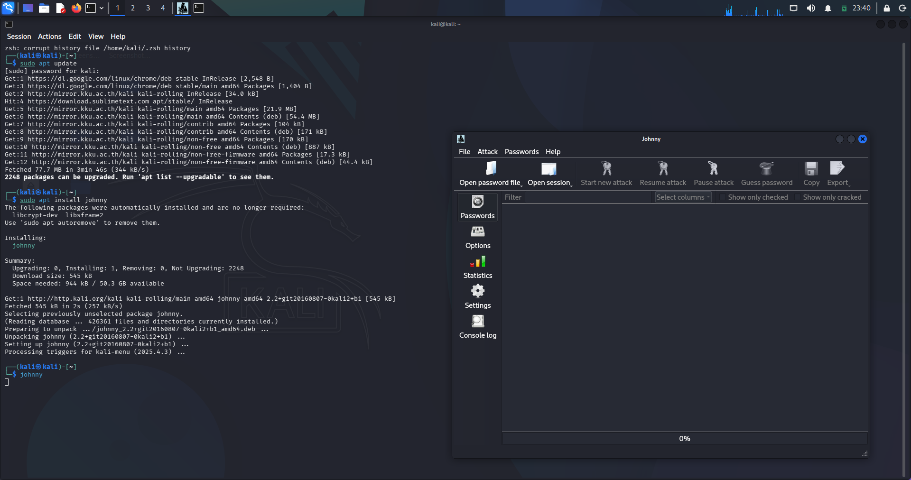

<h1 align="center"> PDF Password Recovery</h1>

<h3 align="center">NetworkWalks Internship</h3>

## Practical Implementation

### 1. Johnny Installation

  

### 2. NetworkWalks – Hash Extraction & Password Recovery

  

### 3. Final Password Recovery & PDF Verification

  

---

## Overview

This repository documents my Week 3 internship task, focused on recovering the password of a protected PDF file using two different approaches.

The task involved extracting PDF hashes, performing password recovery with John the Ripper, and repeating the process using the NetworkWalks Online Password Cracker.

Both approaches were successfully completed, and the recovered password was verified by opening the protected PDF.

## Tools Used

- Kali Linux
- John the Ripper (Johnny GUI)
- NetworkWalks Online Password Cracker
- Online PDF Hash Extraction Tool

## Practical Implementation

### 1. Hash Extraction & John the Ripper

Extracted the password hash from the protected PDF and prepared it for password recovery using John the Ripper.

  

### 2. Password Recovery Using John the Ripper

Performed password recovery using John the Ripper and successfully identified the PDF password.

  

### 3. PDF Hash Extraction Using NetworkWalks Tool

Used the NetworkWalks-supported online hash extraction workflow to obtain the PDF hash.

  

### 4. Password Recovery Using NetworkWalks Tool

Submitted the extracted hash to the NetworkWalks Online Password Cracker and successfully recovered the password.

  

### 5. Final Verification

Used the recovered password to open the protected PDF file and verified the successful result.

  

---

## Key Learning Outcomes

- Understanding PDF password protection and hashing.
- Practical experience with hash extraction.
- Hands-on usage of John the Ripper.
- Experience with online password-recovery tools.
- Comparing two different password-recovery approaches.
- Verifying password recovery results.

## Conclusion

Successfully completed the PDF password recovery task using two different tools and verified the results.

This exercise strengthened my practical understanding of password hashing, hash extraction, and password-recovery techniques.

## Ethical Use

This task was performed for educational purposes using an authorized test PDF. Password-recovery techniques should only be applied to files for which proper authorization has been granted.

---

## Author

**Umaira Asghar**

**Linkedin:https://www.linkedin.com/in/umaira-asghar-825894371**

## Acknowledgment

Grateful to NetworkWalks and my instructor for providing practical learning opportunities and helping me strengthen my cybersecurity knowledge.

---

  <b>Learn • Practice • Explore • Grow</b>

